# 

I design, build and ship **AI systems**, from agents and retrieval to evaluation and production backends.

## What I do

- **Systems & architecture:** AI system design, orchestration and cloud infrastructure.
- **Agents & applications:** Autonomous agents, multi-agent workflows and LLM applications.
- **Retrieval & tools:** RAG pipelines, MCP servers and integrations.
- **Evaluation & production:** Eval suites, regression checks and backend services.

## How I work

```text
$ dileepadev run --task "ship an AI system"

  [1/5] plan    ✓ eval written before the feature
  [2/5] build   ✓ agents get least-privilege scopes, not blanket trust
  [3/5] trace   ✓ every run recorded, every failure turned into a test
  [4/5] ship    ✓ guardrails on, cost tracked per task
  [5/5] learn   ✓ evals re-run, regressions caught before users see them

  ↻ loop: next task starts from what this one taught
```

## After hours

I build [projects ↗](https://dileepa.dev/projects), write [technical articles ↗](https://dileepa.dev/blog), give [talks and workshops ↗](https://dileepa.dev/events), make [educational videos ↗](https://dileepa.dev/videos) and help run [developer communities ↗](https://dileepa.dev/communities).

## Elsewhere

[Website ↗](https://dileepa.dev) ·
[Links ↗](https://links.dileepa.dev) ·
[Build log ↗](https://dileepadev.github.io) ·
[Email ↗](mailto:contact@dileepa.dev)
